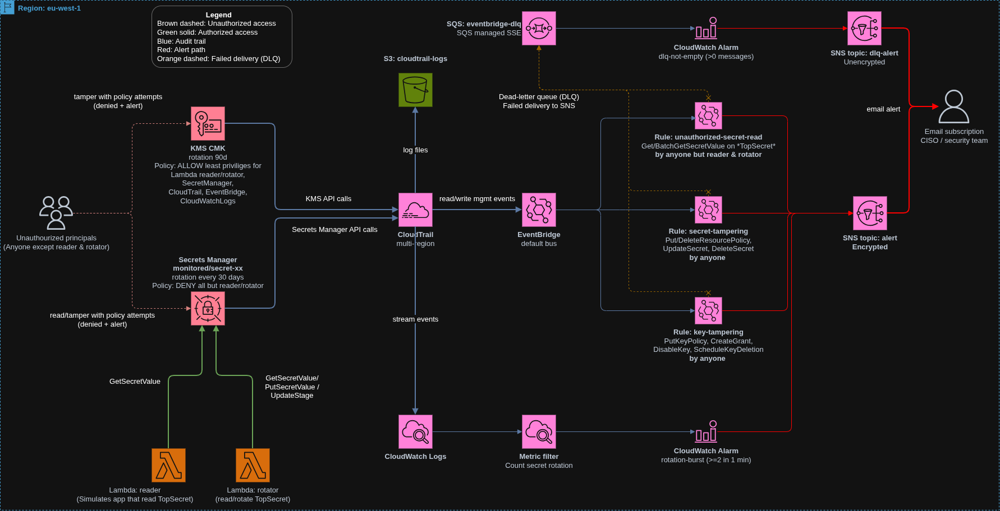

# TopSecret – Monitored Secret with CISO Alerting

## Overview

This projects demonstarates how to protect, audit and alarm about TopSecret tampering attempts.

TopSecret protects a single AWS Secrets Manager secret (`<secret_name>/monitored`) and alerts the security team by email whenever anyone other than the two authorized Lambda functions reads it, tampers with it, or tampers with its KMS key. A resource policy blocks everyone else, and EventBridge rules plus a CloudWatch alarm turn CloudTrail activity into SNS email alerts. The alert chain is guarded by a dead-letter queue, so an attacker who disables the KMS key still cannot silence it. The whole stack is deployed with Terraform in `eu-west-1` and supports separate `test` and `prod` environments.

## Architecture

[](docs/top-secret-architecture.drawio.png)

### How it works ###

1. **Protected asset**: The secret is encrypted with a customer-managed KMS key.

   Its resource policy denies `GetSecretValue` / `BatchGetSecretValue` to everyone except the *reader* Lambda, the *rotator* Lambda, the deploying principal and any ARN in `extra_secret_reader_arns`. 

   The secret rotates every 30 days.

2. **Authorized access**:
   * The *reader* Lambda simulates an application that reads the secret and returns only metadata, never the value. 
   * The *rotator* Lambda reads, rotates and re-stages the secret. 
   
   Both are least-privilege and are the only identities exempt from alerting.

3. **Audit**: A multi-region CloudTrail records all management events. It delivers them to the KMS-encrypted `cloudtrail-logs` S3 bucket and to a CloudWatch Logs group. It also feeds the EventBridge default bus.

4. **Real-time alerts**: Three EventBridge rules publish to the `alert` SNS topic, which emails the CISO / security team:
   - unauthorized-secret-read: `GetSecretValue` / `BatchGetSecretValue` on the secret by anyone but the two Lambdas, including denied attempts.
   - secret-tampering: `PutResourcePolicy`, `DeleteResourcePolicy`, `UpdateSecret`, `DeleteSecret` on the secret.
   - key-tampering: `PutKeyPolicy`, `CreateGrant`, `DisableKey`, `ScheduleKeyDeletion` on the CMK, including denied attempts.

5. **Rotation-burst alarm**: A CloudWatch Logs metric filter counts `RotateSecret` calls. The `rotation-burst` alarm fires at 2 or more rotations within 1 minute and publishes to the same `alert` topic.

6. **Safety net**: If EventBridge cannot deliver to SNS (for example, the CMK was disabled or scheduled for deletion), the event goes to an SQS dead-letter queue.

   The `dlq-not-empty` alarm then notifies a separate, unencrypted `dlq-alert` SNS topic, which emails the same recipient and does not depend on the CMK.

## Best Practices & Design Decisions

**Q: Why EventBridge for the alerts instead of alarms through metric filters on the CloudTrail logs?**

EventBridge reacts to each API call as it happens (seconds) and use an input transformer to produces a readable email with the event name, secret, caller ARN, source IP and time.

On the other hand, CloudTrail logs -> metric filter -> alert, takes time (minutes) and produces general uncleared email.

**Q: Why does the rotation alert go through CloudTrail logs -> metric filter -> alert?**

"Two or more rotations within a minute" is a count over time, which an event pattern can't express.

**Q: How are the two Lambdas excluded from the alerts?**

The read rule uses `anything-but` on their exact assumed-role session ARNs (`assumed-role/<role>/<function-name>`). 
Any other principal, including someone assuming the same role under a different session name, triggers an alert.

**Q: Why a Dead-letter queue (DLQ) is needed in this setup?**

The SNS topic 'alert' uses the CMK to encryt the message at rest (before it sends them).
In case an attacker disables or deletes the CMK the rule 'key-tampering' is matched but the SNS topic 'alert' will not be able to encrypt the messages, so EventBridge deliveries would fail.

The DLQ will capture these messages and produce alerts in an alternative way, not dependent on thd CMK, `dlq-not-empty alarm` -> `dlq-alert SNS topic`.

**Q: Why does the KMS key policy have no `root` statement?**

Access is granted only by the key policy: the deploying principal, the AWS services involved, and the two Lambda roles via `kms:ViaService` conditions. 

IAM policies alone can't grant access to the key, which limits the blast radius. 

**Q: How is the secret value kept out of Terraform state?**

The initial value comes from an `ephemeral` `random_password` and is written with the write-only attribute `secret_string_wo`, so it is never stored in state or plan files. 

Terraform never manages the value again (`ignore_changes`), and the first rotation replaces it with a value only Secrets Manager and the rotator know.

**Q: Can the Lambdas leak the secret?**

No,the reader logs and returns only the secret ID, version ID and value length. 

The rotator logs only the version ID.

Their IAM roles allow only the secret they need, and their KMS access is limited to calls made via Secrets Manager.

**Q: How are the SNS topic and SQS queue protected from abuse?**

Their policies allow publishing only from the three EventBridge rules (and the specific alarms) via `aws:SourceArn`, plus `aws:SourceAccount` for CloudWatch, which prevents the confused-deputy problem.

**Q: How is the audit trail hardened?**

CloudTrail is multi-region with log-file validation. 

The S3 bucket is KMS-encrypted, blocks all public access, denies non-TLS requests and has ACLs disabled (`BucketOwnerEnforced`). 

Logs move to Glacier Instant Retrieval after 30 days and expire after 365. 

The CloudWatch Logs group keeps 90 days for live querying.

**Q: How do `test` and `prod` differ?**

`environment = "prod"` gives the secret a 30-day recovery window and sets `force_destroy = false` on the log bucket. 

In `test` the secret is deleted immediately and the bucket is force-destroyed, which keeps teardown quick. 

Every resource is prefixed with `project_name`, so the two environments don't collide.

## Deployment instructions

### 1. Prerequisites / Bootstrap

Complete the one-time setup on the **[Prerequisites page](docs/prerequisites.md#create-s3-bucket-to-store-terraform-state-files-and-enable-versioning)** (Terraform state bucket with versioning).

You also need:

- Terraform `~> 1.11` (AWS provider `~> 6.0`)
- AWS CLI v2 with credentials for the target account. Use the same IAM identity for deploy, test and destroy.
- A mailbox you can access, to confirm the SNS subscriptions.

### 2. Configure Terraform variables

Edit the file for your environment: **[`terraform/envs/test.tfvars`](terraform/envs/test.tfvars)** or **[`terraform/envs/prod.tfvars`](terraform/envs/prod.tfvars)**.

| Variable | Description | Default |
|---|---|---|
| `environment` | `test` or `prod` (prod enables the 30-day secret recovery window and keeps the log bucket on destroy) | none (required) |
| `project_name` | Prefix for all resource names | `top-secret` |
| `secret_name` | The secret is created as `<secret_name>/monitored` | none (required) |
| `alert_email` | Mailbox that receives all alerts. **Required**, and you must confirm the subscription. | `""` |
| `extra_secret_reader_arns` | Extra principals allowed to read the secret (for example, break-glass). They are still alerted on. | `[]` |
| `region` / `owner` | Region and `Owner` tag | `eu-west-1` / `security-team` |

Before deploying, replace `alert_email` with your own mailbox and replace or empty the hard-coded `extra_secret_reader_arns` entry in `test.tfvars`.

### 3. Deploy

```bash
cd terraform

terraform init
terraform plan  -var-file=envs/test.tfvars -out=tfplan
terraform apply tfplan
```

Use `envs/prod.tfvars` for production.

After the apply:

1. **Confirm both subscription emails** from AWS (one for `<project_name>-alert`, one for `<project_name>-dlq-alert`). Alerts are not delivered until each subscription is confirmed.
2. Check that they are confirmed:
   ```bash
   aws sns list-subscriptions --query "Subscriptions[?contains(TopicArn,'<project_name>')].[TopicArn,SubscriptionArn]" --output table
   ```
   `PendingConfirmation` means the email hasn't been confirmed yet.

> **Notes**
> - The alert rules exempt only the two Lambda roles, so actions by the deploying identity (for example, the policy being created during the first apply) can also generate alert emails.
> - `backend.tf` uses a fixed state key. To deploy `test` and `prod` side by side from the same bucket, give each its own key: `terraform init -reconfigure -backend-config="key=<env>/terraform.tfstate"`.

### 4. Test setup

Set these variables once. Take `PROJECT_NAME` and the secret name from your tfvars file.

```bash
export AWS_REGION=eu-west-1
PROJECT_NAME="top-secret"                 # project_name in your tfvars
SECRET_ID="Secret01/monitored"            # <secret_name>/monitored
KMS_ALIAS="alias/${PROJECT_NAME}"
KEY_ID=$(aws kms describe-key --key-id "$KMS_ALIAS" --query KeyMetadata.KeyId --output text)
```

Email alerts normally arrive within about a minute for EventBridge rules. The alarms (rotation burst, DLQ) take about 5 to 10 minutes. Run the tests **in this order** so that any alert can be attributed to the step that caused it.

> Run these in `test`. Some steps temporarily weaken protection on the secret or the key, and each says how to restore it.

#### 4.1 Lambda functions do NOT trigger any alert

Run this first. Wait for any emails caused by the deployment to arrive, then start from a clean baseline:

```bash
# Alarms start in OK state and the DLQ is empty
aws cloudwatch describe-alarms \
  --alarm-names "${PROJECT_NAME}-rotation-burst" "${PROJECT_NAME}-eventbridge-dlq-not-empty" \
  --query "MetricAlarms[].[AlarmName,StateValue]" --output table

DLQ_URL=$(aws sqs get-queue-url --queue-name "${PROJECT_NAME}-eventbridge-dlq" --query QueueUrl --output text)
aws sqs get-queue-attributes --queue-url "$DLQ_URL" --attribute-names ApproximateNumberOfMessages
```

Then exercise both Lambdas:

```bash
# 1. Reader Lambda reads the secret (returns metadata only)
aws lambda invoke --function-name "${PROJECT_NAME}-lambda-reader" /dev/stdout

# 2. Rotator Lambda runs: start ONE rotation (the rotator reads + writes the secret)
aws secretsmanager rotate-secret --secret-id "$SECRET_ID"
```

**Expected:** no email arrives, even after about 10 minutes. The `rotation-burst` alarm stays `OK` (one rotation is below the threshold of 2) and the DLQ stays empty.

To prove the Lambda reads were actually recorded and deliberately ignored, check CloudTrail. The user name is the function name:

```bash
aws cloudtrail lookup-events \
  --lookup-attributes AttributeKey=EventName,AttributeValue=GetSecretValue \
  --max-results 10 --query "Events[].[EventTime,Username]" --output table
```

You should see `${PROJECT_NAME}-lambda-reader` and `${PROJECT_NAME}-lambda-rotator` entries, and no alert for them.

#### 4.2 Rule `unauthorized-secret-read`

| Test | Command | Expected |
|---|---|---|
| **Denied read** by a principal that is not on the allow list (use a second IAM user or role profile) | `aws secretsmanager get-secret-value --secret-id "$SECRET_ID" --profile <other-profile>` | `AccessDeniedException` **and** an email: `Unauthorized secret read ALERT: GetSecretValue on <secret> by <arn> from <ip> at <time>` |
| **Allowed** read by the deployer or an `extra_secret_reader_arns` principal | `aws secretsmanager get-secret-value --secret-id "$SECRET_ID" --query VersionId` | The call succeeds, and the same alert email arrives (only the two Lambdas are exempt). The query keeps the secret value off your screen. |
| **Batch** read | `aws secretsmanager batch-get-secret-value --secret-id-list "$SECRET_ID" --query "SecretValues[].VersionId"` | Alert email with `BatchGetSecretValue` |

#### 4.3 Rule `secret-tampering`

First save the current policy and description so you can restore them:

```bash
aws secretsmanager get-resource-policy --secret-id "$SECRET_ID" --query ResourcePolicy --output text > /tmp/secret-policy.json
```

| Event | Command | Expected |
|---|---|---|
| `UpdateSecret` | `aws secretsmanager update-secret --secret-id "$SECRET_ID" --description "alert test"` | Email: `Secret tampering ALERT: UpdateSecret on <secret> by ...` |
| `PutResourcePolicy` | `aws secretsmanager put-resource-policy --secret-id "$SECRET_ID" --resource-policy file:///tmp/secret-policy.json` | Alert `PutResourcePolicy` (re-applies the same policy, so no net change) |
| `DeleteResourcePolicy` | `aws secretsmanager delete-resource-policy --secret-id "$SECRET_ID"` | Alert `DeleteResourcePolicy`. **Restore immediately** with the `put-resource-policy` command above. |
| `DeleteSecret` | `aws secretsmanager delete-secret --secret-id "$SECRET_ID" --recovery-window-in-days 7` | Alert `DeleteSecret`. **Restore:** `aws secretsmanager restore-secret --secret-id "$SECRET_ID"`. The explicit recovery window matters because the `test` environment would otherwise allow immediate deletion. |

Restore the description, then confirm there is no drift:

```bash
aws secretsmanager update-secret --secret-id "$SECRET_ID" --description "Monitored secret for CISO alerting pipeline"   # fires one more alert
cd terraform && terraform plan -var-file=envs/test.tfvars     # expect: No changes
```

#### 4.4 Rule `key-tampering`

```bash
aws kms get-key-policy --key-id "$KMS_ALIAS" --policy-name default --query Policy --output text > /tmp/key-policy.json
```

| Event | Command | Expected |
|---|---|---|
| `PutKeyPolicy` | `aws kms put-key-policy --key-id "$KMS_ALIAS" --policy-name default --policy file:///tmp/key-policy.json` | Email: `Key tampering ALERT: PutKeyPolicy on the KMS key by ...` (same policy re-applied) |
| `CreateGrant` | `aws kms create-grant --key-id "$KMS_ALIAS" --grantee-principal "$(aws sts get-caller-identity --query Arn --output text)" --operations Decrypt` | Alert `CreateGrant`. Clean up with `aws kms list-grants --key-id "$KEY_ID"`, then `aws kms revoke-grant --key-id "$KEY_ID" --grant-id <id>`. |
| **Denied** variants (`DisableKey`, `ScheduleKeyDeletion`, ...) from a principal with no access to the key | `aws kms disable-key --key-id "$KEY_ID" --profile <other-profile>` | `AccessDenied`, and **still an alert**. The rule also matches the key ID in the error message of denied calls. This is a safe way to test those events. |

`DisableKey` and `ScheduleKeyDeletion` by an *authorized* principal break the alert chain itself, so they are covered by the DLQ test below.

#### 4.5 Alarm `rotation-burst`

Fire several rotations back-to-back so that at least two land in the same 1-minute window:

```bash
for i in 1 2 3; do aws secretsmanager rotate-secret --secret-id "$SECRET_ID" || true; done
```

**Expected:** within 5 to 10 minutes the alarm goes to `ALARM` and an email `ALARM: "<project_name>-rotation-burst"` arrives. It returns to `OK` on its own afterwards.

```bash
aws cloudwatch describe-alarms --alarm-names "${PROJECT_NAME}-rotation-burst" --query "MetricAlarms[].StateValue"
```

The rotator Lambda reading the secret during these rotations does **not** produce `unauthorized-secret-read` alerts.

#### 4.6 Dead-letter queue path (CMK disabled or deleted)

This simulates an attacker silencing the alerts by disabling the key.

```bash
aws kms disable-key --key-id "$KEY_ID"
```

**Expected:**

1. The `DisableKey` event matches `key-tampering`, but EventBridge cannot publish to the CMK-encrypted `alert` topic, so **no normal alert email arrives**.
2. After the retries are exhausted (up to 10 attempts or 1 hour per the rule's retry policy), the event lands in the DLQ:
   ```bash
   aws sqs get-queue-attributes --queue-url "$DLQ_URL" --attribute-names ApproximateNumberOfMessages
   ```
3. The `dlq-not-empty` alarm fires and an email arrives from the **unencrypted** `<project_name>-dlq-alert` topic.

Keep the key disabled until the DLQ email arrives. Re-enabling it earlier lets the retries succeed and no DLQ message is produced. While the key is disabled, the Lambdas and CloudTrail can't use it, so keep this test short. Then recover:

```bash
aws kms enable-key --key-id "$KEY_ID"
aws sqs purge-queue --queue-url "$DLQ_URL"    # the alarm returns to OK
```

`ScheduleKeyDeletion` behaves the same way. Use `aws kms schedule-key-deletion --key-id "$KEY_ID" --pending-window-in-days 7` and recover with `aws kms cancel-key-deletion --key-id "$KEY_ID"` followed by `aws kms enable-key --key-id "$KEY_ID"`, because cancelling leaves the key disabled.

#### Test summary

| # | Scenario | Trigger | Alert path | Expected |
|---|---|---|---|---|
| 1 | Reader / rotator Lambdas | `lambda invoke`, one `rotate-secret` | none | **No alert** |
| 2 | Unauthorized read | `get-secret-value`, `batch-get-secret-value` | EventBridge → `alert` topic | Email |
| 3 | Secret tampering | `update-secret`, `put/delete-resource-policy`, `delete-secret` | EventBridge → `alert` topic | Email |
| 4 | Key tampering | `put-key-policy`, `create-grant`, denied `disable-key` | EventBridge → `alert` topic | Email |
| 5 | Rotation burst | ≥ 2 × `rotate-secret` in 1 min | Metric filter → alarm → `alert` topic | Alarm email |
| 6 | Alert chain sabotage | `disable-key` / `schedule-key-deletion` | EventBridge → DLQ → alarm → `dlq-alert` topic | DLQ alarm email |

## Destroy & Cleanup

1. Destroy the stack (use the same identity and tfvars file you deployed with):
   ```bash
   cd terraform
   terraform destroy -var-file=envs/test.tfvars
   ```
2. Remove the Terraform state bucket **last**, following the **[Cleanup section of the Prerequisites page](docs/prerequisites.md#delete-prerequisites)**.

Things to know:

- **`prod`:** the log bucket has `force_destroy = false`, so empty it first or the destroy will fail.
- **Secret:** `prod` keeps the secret for a 30-day recovery window, during which its name can't be reused. To remove it sooner, run `aws secretsmanager delete-secret --secret-id <secret> --force-delete-without-recovery`.
- **KMS key:** it enters a 7-day pending-deletion window rather than disappearing immediately.
